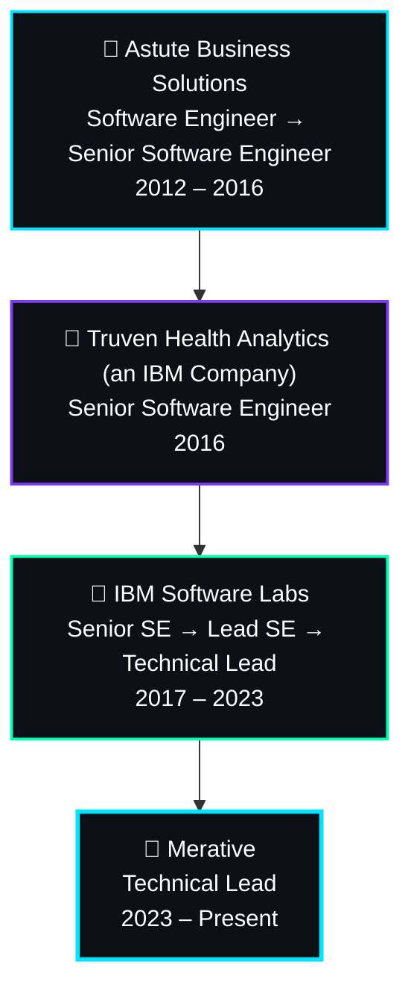

<div align="center">


<a href="https://www.linkedin.com/in/ramprakasham">
  
</a>

<br/>


[](https://www.linkedin.com/in/ramprakasham)
[](mailto:ramprakasism@yahoo.com)

</div>

<br/>

## 🧭 About Me

```yaml
name: "Ramprakash Munugapati"
title: "Lead Software Engineer & Technical Architect"
focus: ["Digital Transformation", "Enterprise Observability", "Cloud & AI Solutions"]
experience: "15+ years"
based_in: "Hyderabad, India"
current: "Technical Lead @ Merative"
```

- 🔭 Hands-on **Technical Lead & Full-Stack Architect** specialized in cloud-native platforms, healthcare software, and intelligent systems
- 🏗️ **13+ years** bridging complex software architecture with cross-functional team execution across IBM, Truven Health Analytics, and Merative
- ☁️ Deep expertise in **Java, Spring Boot, Microservices, Azure/IBM Cloud, Kubernetes** — designing scalable enterprise-grade solutions
- 🤖 Productionizing **AI/ML solutions** — agentic developer helpers, intelligent chatbot integrations, and real-time observability platforms
- 🧑‍🏫 People-first mentor — coaching engineers, driving Agile best practices, and building high-performance engineering culture
- 🤝 Volunteers with the **Friends Food Recovery Network**, giving back to local communities through tech-for-good initiatives
- 💡 Currently deepening expertise in **GenAI, LLMs, MCP servers, and AI agent architectures**

<br/>

## 🛠️ Tech Stack

<div align="center">

**Backend**


**Frontend**


**Cloud**


**DevOps**


**Databases**


**Identity & Security**


**AI & Automation**


</div>

<br/>

## 📊 GitHub Analytics

<div align="center">


</div>

<br/>

## 🚀 Featured Projects

<table>
<tr>
<td width="50%">

### 📁 ShiftSaathi
Document lifecycle management platform for Indian citizens — a 6-Action Framework (Apply, Transfer, Renew, Correct, Replace, Link) across 80+ services with a 3-layer access model (User/Agent/Admin) and a DocVault subscription tier.

`Spring Boot 3.x` `Java 17` `React` `TypeScript` `PostgreSQL` `Redis` `AWS S3` `Razorpay`

[](#)
[](#)

</td>
<td width="50%">

### 💰 Finance Command Center
Production-grade personal finance monorepo aggregating 22+ modules — investments, trading, loans, taxes, and a secure password manager — built for real-world financial tracking.

`Next.js` `NestJS` `Prisma` `PostgreSQL`

[](#)
[](#)

</td>
</tr>
<tr>
<td width="50%">

### 🧭 Wealth Yatra
Interactive investment roadmap tool for the Indian market covering SIPs, REITs, SGBs, P2P lending, and freelance income streams.

`React` `TypeScript` `Data Visualization`

[](#)
[](#)

</td>
<td width="50%">

### 🩺 Enterprise Healthcare Platforms
Architected and led delivery of cutting-edge healthcare software solutions at IBM Watson Health / Merative, spanning cloud-native microservices, identity management, and observability.

`Java` `Spring Boot` `Microservices` `Azure` `Kubernetes`

[](#)

</td>
</tr>
</table>

<br/>

## 🧗 Professional Timeline



<br/>

## 🎓 Certifications

<div align="center">


</div>

<br/>

## 🔬 Currently Learning

<div align="center">


</div>

<br/>

## 🌐 Connect With Me

<div align="center">

[](https://www.linkedin.com/in/ramprakasham)
[](mailto:ramprakasism@yahoo.com)
[](#)
[](#)
[](#)
[](#)

</div>

> 💡 *Replace the "Add Your Link" placeholders above with your actual Portfolio, X, Medium, and YouTube URLs when ready.*

<br/>

## ⚡ Fun Facts

<div align="center">

| ☕ Coffee-Powered | ❤️ Open Source | 🧩 Problem Solver | 📚 Always Learning | 🤖 AI Explorer | 🤝 Community Volunteer |
|:---:|:---:|:---:|:---:|:---:|:---:|
| Runs on caffeine & clean architecture | Believer in giving back to the dev community | Loves untangling gnarly legacy systems | Never stops upskilling | Building agentic tools & MCP workflows | Friends Food Recovery Network |

</div>

<br/>

<div align="center">


**"Building scalable systems today while shaping AI-powered solutions for tomorrow."**

</div>
