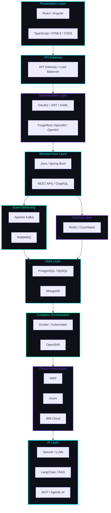
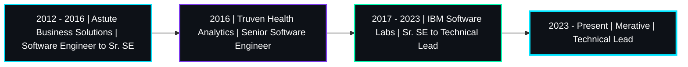

<!-- ======================================================================== -->
<!-- SECTION 1: PREMIUM HERO BANNER                                           -->
<!-- ======================================================================== -->

<!-- Hero Banner - Inline SVG with text fallback -->
<table style="width:100%;border-collapse:collapse;background-color:#0D1117;">
<tr>
<td align="center" style="padding:40px 20px 30px 20px;">
  
Ramprakash Munugapati

   
  
Technical Lead | Enterprise Architect | Cloud &amp; AI Engineer

   
  

</td>
</tr>
</table>

<svg width="0" height="0" viewBox="0 0 1000 280" xmlns="http://www.w3.org/2000/svg" style="position:absolute;visibility:hidden;" aria-hidden="true">
  <defs>
    <linearGradient id="hBg"><stop offset="0%" stop-color="#0D1117"/><stop offset="100%" stop-color="#0D1117"/></linearGradient>
    <linearGradient id="hAccent"><stop offset="0%" stop-color="#00E5FF"/><stop offset="50%" stop-color="#7C3AED"/><stop offset="100%" stop-color="#00FFB3"/></linearGradient>
  </defs>
  <rect width="1000" height="280" fill="url(#hBg)"/>
  <text x="500" y="145" font-family="system-ui,sans-serif" font-size="48" font-weight="700" fill="url(#hAccent)" text-anchor="middle" dominant-baseline="middle">Ramprakash Munugapati</text>
</svg>

<!-- ======================================================================== -->
<!-- SECTION 2: PROFESSIONAL PROFILE PHOTO (Initials Avatar)                  -->
<!-- ======================================================================== -->

<a href="https://www.linkedin.com/in/ramprakasham">
  <picture>
    <source media="(prefers-color-scheme: dark)" srcset="data:image/svg+xml,%3Csvg xmlns='http://www.w3.org/2000/svg' width='160' height='160' viewBox='0 0 160 160'%3E%3Cdefs%3E%3ClinearGradient id='g' x1='0%25' y1='0%25' x2='100%25' y2='100%25'%3E%3Cstop offset='0%25' stop-color='%2300E5FF'/%3E%3Cstop offset='100%25' stop-color='%237C3AED'/%3E%3C/linearGradient%3E%3ClinearGradient id='border' x1='0%25' y1='0%25' x2='100%25' y2='100%25'%3E%3Cstop offset='0%25' stop-color='%2300FFB3'/%3E%3Cstop offset='100%25' stop-color='%2300E5FF'/%3E%3C/linearGradient%3E%3C/defs%3E%3Ccircle cx='80' cy='80' r='75' fill='url(%23border)'/%3E%3Ccircle cx='80' cy='80' r='71' fill='%230D1117'/%3E%3Ccircle cx='80' cy='80' r='71' fill='url(%23g)' opacity='0.15'/%3E%3Ctext x='80' y='88' font-family='system-ui,-apple-system,sans-serif' font-size='52' font-weight='700' fill='url(%23g)' text-anchor='middle' dominant-baseline='middle'%3ERM%3C/text%3E%3C/svg%3E">
    
  </picture>
</a>

<!-- ======================================================================== -->
<!-- SECTION 3: ANIMATED TYPING                                               -->
<!-- ======================================================================== -->

 
 

 

<!-- ======================================================================== -->
<!-- SECTION 4: SOCIAL BUTTONS                                                -->
<!-- ======================================================================== -->

 
 

 
 

<!-- ======================================================================== -->
<!-- SECTION 5: PROFESSIONAL EXECUTIVE SUMMARY                                -->
<!-- ======================================================================== -->

<table>
<tr>
<td width="65%" valign="top">

### Enterprise Technical Lead

Results-driven **Technical Lead** with **15+ years** of experience architecting and delivering enterprise-scale software solutions. Currently leading engineering teams at **Merative** (formerly IBM Watson Health), building cloud-native healthcare platforms that serve millions of users across the globe.

Proven track record of designing distributed systems, microservices architectures, and identity management solutions across **IBM Software Labs**, **Truven Health Analytics** (an IBM Company), and **Astute Business Solutions**. Experienced in managing full product lifecycles from concept through delivery, operations, and continuous improvement.

Deeply passionate about **AI engineering**, **cloud-native architecture**, and **mentoring** the next generation of software engineers. Combines strong technical depth with strategic thinking to deliver measurable business outcomes. Advocate for clean code, automation, observability, and security-first design principles.

Specializes in bridging the gap between business requirements and technical execution — translating complex stakeholder needs into scalable, maintainable, and secure software systems. Believes in building teams as much as building products, with a track record of growing engineers into technical leaders.

</td>
<td width="35%" valign="top">

### Core Competencies

| Area | Expertise |
|:-----|:----------|
| **Architecture** | Enterprise, Microservices, Cloud-Native, Event-Driven |
| **Backend** | Java, Spring Boot, REST, GraphQL, Kafka |
| **Frontend** | React, Angular, TypeScript, TailwindCSS |
| **Cloud** | AWS, Azure, IBM Cloud, Kubernetes, OpenShift |
| **AI/ML** | LLMs, RAG, MCP, LangChain, Prompt Engineering, Agentic AI |
| **Identity** | OAuth2, SAML, JWT, ForgeRock OpenAM, OpenDJ |
| **Data** | PostgreSQL, MySQL, MongoDB, Redis, Couchbase |

### Location & Availability

| | |
|:---|:---|
| **Based in** | Hyderabad, India |
| **Time Zone** | IST (UTC +5:30) |
| **Languages** | English (Professional Working), Telugu, Hindi |
| **Open to** | Remote · Hybrid · Relocation |
| **Work Mode** | Full-time · Contract · Advisory |

</td>
</tr>
</table>

<!-- ======================================================================== -->
<!-- SECTION 5b: WHAT I DO (Expanded Detail)                                  -->
<!-- ======================================================================== -->

 

#### What I Do

- **Architect** cloud-native, microservices-based platforms that scale to millions of users
- **Lead** cross-functional engineering teams distributed across geographies and time zones
- **Design** identity and access management solutions for enterprise compliance requirements
- **Build** AI-powered features and agentic workflows using LLMs, RAG, and MCP
- **Migrate** legacy monoliths to modern cloud architectures with minimal business disruption
- **Mentor** engineers at all levels — from fresh graduates to senior staff engineers
- **Define** engineering standards, code review processes, and architectural governance
- **Drive** adoption of DevOps practices including CI/CD, infrastructure as code, and observability

 

#### Industries Served

| Industry | Experience |
|:---------|:-----------|
| **Healthcare & Life Sciences** | 8+ years building HIPAA-compliant platforms at IBM Watson Health and Merative |
| **Enterprise Software** | 5+ years developing B2B platforms and SaaS solutions at Astute |
| **Health Analytics** | Deep experience with healthcare data, analytics, and population health management |
| **Cloud Services** | Extensive work across AWS, Azure, and IBM Cloud for enterprise migration and modernization |
| **Financial Technology** | Building personal finance platforms with investment tracking, taxation, and portfolio management |

 

<!-- ======================================================================== -->
<!-- SECTION 6: PROFESSIONAL STATISTICS                                       -->
<!-- ======================================================================== -->

### Professional Impact

 

<table>
<tr>
<td align="center" width="12.5%" valign="top">
   
  Industry Experience
</td>
<td align="center" width="12.5%" valign="top">
   
  Enterprise Leaders
</td>
<td align="center" width="12.5%" valign="top">
   
  Cloud Platforms
</td>
<td align="center" width="12.5%" valign="top">
   
  Programming Languages
</td>
<td align="center" width="12.5%" valign="top">
   
  Enterprise Projects
</td>
<td align="center" width="12.5%" valign="top">
   
  Engineers Mentored
</td>
<td align="center" width="12.5%" valign="top">
   
  AI & GenAI Technologies
</td>
<td align="center" width="12.5%" valign="top">
   
  Architecture Patterns
</td>
</tr>
</table>

 

<!-- ======================================================================== -->
<!-- SECTION 7: TRUSTED BY                                                    -->
<!-- ======================================================================== -->

### Trusted By

 

<table>
<tr>
<td align="center" width="25%" valign="top">
   
  Technical Lead 
  2023 - Present
</td>
<td align="center" width="25%" valign="top">
   
  Sr. SE to Technical Lead 
  2017 - 2023
</td>
<td align="center" width="25%" valign="top">
   
  Senior Software Engineer 
  2016
</td>
<td align="center" width="25%" valign="top">
   
  SE to Senior SE 
  2012 - 2016
</td>
</tr>
</table>

 
 

<!-- ======================================================================== -->
<!-- SECTION 8: TECH STACK                                                    -->
<!-- ======================================================================== -->

### Technology Stack

 

<table>
<tr>
<th width="16%">Category</th>
<th>Technologies</th>
</tr>
<tr>
<td align="center" valign="middle"><b>Backend</b></td>
<td>
  
  
  
  
  
  
  
  
  
  
  
  
</td>
</tr>
<tr>
<td align="center" valign="middle"><b>Frontend</b></td>
<td>
  
  
  
  
  
  
  
  
</td>
</tr>
<tr>
<td align="center" valign="middle"><b>Cloud & DevOps</b></td>
<td>
  
  
  
  
  
  
  
  
  
  
  
  
  
</td>
</tr>
<tr>
<td align="center" valign="middle"><b>Databases</b></td>
<td>
  
  
  
  
  
</td>
</tr>
<tr>
<td align="center" valign="middle"><b>Identity & Security</b></td>
<td>
  
  
  
  
  
</td>
</tr>
<tr>
<td align="center" valign="middle"><b>AI & Automation</b></td>
<td>
  
  
  
  
  
  
  
  
</td>
</tr>
</table>

 

#### Daily Development Environment

 
 

<!-- ======================================================================== -->
<!-- SECTION 9: GITHUB DASHBOARD                                              -->
<!-- ======================================================================== -->

### GitHub Dashboard

 

&nbsp;&nbsp;

&nbsp;&nbsp;

&nbsp;&nbsp;

 
 

 
 

 
 

 
 

<table>
<tr>
<td align="center" width="25%" valign="top">
  
</td>
<td align="center" width="25%" valign="top">
  
</td>
<td align="center" width="25%" valign="top">
  
</td>
<td align="center" width="25%" valign="top">
  
</td>
</tr>
</table>

 

<picture>
  <source media="(prefers-color-scheme: dark)" srcset="https://raw.githubusercontent.com/ramprakash-munugapati/ramprakash-munugapati/output/github-contribution-grid-snake-dark.svg">
  <source media="(prefers-color-scheme: light)" srcset="https://raw.githubusercontent.com/ramprakash-munugapati/ramprakash-munugapati/output/github-contribution-grid-snake.svg">
  
</picture>

Snake animation runs daily via a scheduled GitHub Action. The workflow is already configured in <code>.github/workflows/snake.yml</code>. It will appear after the first successful run (push to main, then go to Actions tab to trigger it manually, or wait for the daily schedule).

 
 

<!-- ======================================================================== -->
<!-- SECTION 10: ENTERPRISE ARCHITECTURE                                      -->
<!-- ======================================================================== -->

### Enterprise Architecture

 

<i>End-to-end architecture for cloud-native enterprise platforms</i>

 

 

<table>
<tr>
<td width="50%" valign="top">

#### Architecture Flow

1. **Presentation Layer** — React/Angular with TypeScript, TailwindCSS
2. **API Gateway** — Routing, rate limiting, load balancing
3. **Authentication Layer** — OAuth2/JWT/SAML, ForgeRock OpenAM
4. **Microservices Layer** — Java/Spring Boot, REST/GraphQL
5. **Event Streaming** — Apache Kafka, RabbitMQ
6. **Caching Layer** — Redis, Couchbase
7. **Data Layer** — PostgreSQL, MySQL, MongoDB
8. **Container Orchestration** — Docker, Kubernetes, OpenShift
9. **Cloud Infrastructure** — AWS, Azure, IBM Cloud
10. **AI Layer** — OpenAI LLMs, LangChain RAG, MCP agents

</td>
<td width="50%" valign="top">

#### Key Architecture Decisions

| Decision | Rationale |
|:---------|:----------|
| **Microservices** | Independent scaling, team autonomy |
| **Event-Driven** | Loose coupling, resilience, audit trail |
| **API Gateway** | Centralized auth, routing, monitoring |
| **Multi-Cloud** | Vendor independence, DR, compliance |
| **Kubernetes** | Auto-scaling, self-healing, portability |
| **AI Integration** | Intelligent automation, personalization |
| **OAuth2/SAML** | Enterprise SSO, HIPAA/GDPR compliance |
| **CQRS + Events** | Audit readiness, separated read/write |

</td>
</tr>
</table>

 
 

<!-- ======================================================================== -->
<!-- SECTION 11: CAREER TIMELINE                                              -->
<!-- ======================================================================== -->

### Career Journey

 

<i>15+ years of progressive leadership in enterprise software</i>

 

 

<table>
<tr>
<td width="50%" valign="top">

#### Astute Business Solutions (2012 – 2016)
**Software Engineer → Senior Software Engineer**

- Started career building enterprise web applications using Java, Spring, Hibernate, and AngularJS
- Developed B2B SaaS platforms for supply chain and logistics management
- Led migration from legacy Struts-based architecture to Spring MVC and Hibernate
- Mentored junior developers and established code review practices
- Gained foundational experience in Agile methodologies and continuous delivery

</td>
<td width="50%" valign="top">

#### Truven Health Analytics (2016)
**Senior Software Engineer**

- Joined the healthcare analytics division (an IBM Company at the time)
- Built population health management platforms using Java microservices
- Worked with healthcare data standards including HL7 and FHIR
- Expanded expertise into cloud deployment and containerization
- Collaborated with data science teams on analytics pipelines

</td>
</tr>
<tr>
<td width="50%" valign="top">

#### IBM Software Labs (2017 – 2023)
**Senior SE → Lead SE → Technical Lead**

- Led cloud-native transformation of IBM Watson Health platforms
- Architected identity and access management solutions with OAuth2, SAML, and ForgeRock OpenAM
- Designed and implemented microservices architecture using Spring Boot, Kafka, and Kubernetes
- Defined engineering standards, coding conventions, and architectural governance
- Mentored 30+ engineers across multiple teams and locations
- Drove adoption of DevOps practices including CI/CD, IaC, and observability
- Managed stakeholder relationships and technical roadmap planning

</td>
<td width="50%" valign="top">

#### Merative (2023 – Present)
**Technical Lead**

- Leading enterprise architecture and engineering for healthcare platforms
- Driving microservices modernization and cloud-native adoption
- Integrating AI capabilities using LLMs, RAG, and agentic architectures
- Establishing platform observability with distributed tracing and centralized logging
- Building engineering culture focused on quality, security, and continuous improvement
- Collaborating with product, design, and operations to deliver user-centric solutions
- Defining technical strategy aligned with business objectives and compliance requirements

</td>
</tr>
</table>

 
 

<!-- ======================================================================== -->
<!-- SECTION 12: FEATURED PROJECTS                                            -->
<!-- ======================================================================== -->

### Featured Projects

 

<table>
<tr>
<td width="50%" valign="top">

#### 📁 ShiftSaathi

Document lifecycle management platform for Indian citizens. Implements a 6-Action Framework (Apply, Transfer, Renew, Correct, Replace, Link) across 80+ services with a 3-layer access model (User/Agent/Admin) and DocVault subscription tier.

| Detail | Value |
|:-------|:------|
| **Architecture** | Microservices, Event-Driven |
| **Backend** | Spring Boot 3.x, Java 17 |
| **Frontend** | React, TypeScript |
| **Database** | PostgreSQL, Redis |
| **Cloud** | AWS S3, Docker |
| **Payments** | Razorpay Integration |
| **Identity** | JWT, OAuth2 |
| **Search** | Elasticsearch |

#### Key Features

- Multi-role access control (User, Agent, Admin)
- Document upload, verification, and tracking
- Subscription-based DocVault storage tier
- Real-time status notifications
- Search and filter across 80+ document services
- Mobile-responsive interface

</td>
<td width="50%" valign="top">

#### 💰 Finance Command Center

Production-grade personal finance monorepo aggregating 22+ modules including investments, trading, loans, taxes, insurance, budget tracking, net worth calculation, and secure password management. Built with modern full-stack architecture.

| Detail | Value |
|:-------|:------|
| **Architecture** | Monorepo, Modular Monolith |
| **Backend** | NestJS, Prisma ORM |
| **Frontend** | Next.js, TypeScript |
| **Database** | PostgreSQL |
| **Auth** | JWT, OAuth2 |
| **Deployment** | Docker, Vercel |
| **Testing** | Jest, Cypress |
| **CI/CD** | GitHub Actions |

#### Key Features

- Investment portfolio tracking (stocks, mutual funds, ETFs)
- Tax planning and filing assistance
- Loan and EMI management
- Budget and expense categorization
- Insurance policy dashboard
- Encrypted password vault
- Net worth tracking and projections
- Data export and reporting

</td>
</tr>
<tr>
<td width="50%" valign="top">

#### 🧭 Wealth Yatra

Interactive investment roadmap tool for the Indian market covering SIPs, REITs, SGBs, P2P lending, mutual funds, fixed deposits, NPS, and freelance income streams with rich data visualizations and personalized recommendations.

| Detail | Value |
|:-------|:------|
| **Architecture** | SPA, Data-Driven Design |
| **Frontend** | React, TypeScript |
| **Visualization** | D3.js, Chart.js |
| **State Management** | Redux Toolkit |
| **Styling** | TailwindCSS |
| **API** | Node.js, Express |
| **Cache** | Redis |
| **Auth** | Firebase Auth |

#### Key Features

- Interactive investment journey maps
- Risk profiling and personalized recommendations
- Goal-based investment planning
- Tax-saving investment suggestions
- Market data integration and analysis
- Educational content on investment products

</td>
<td width="50%" valign="top">

#### 🩺 Enterprise Healthcare Platform

Architected and led delivery of enterprise healthcare software at IBM Watson Health / Merative. Cloud-native microservices with comprehensive identity management, observability, and regulatory compliance for healthcare providers.

| Detail | Value |
|:-------|:------|
| **Architecture** | Cloud-Native, Distributed Systems |
| **Backend** | Java, Spring Boot, Kafka |
| **Identity** | OAuth2, SAML, ForgeRock OpenAM |
| **Infrastructure** | Kubernetes, Azure, OpenShift |
| **Observability** | ELK Stack, Prometheus, Grafana |
| **Security** | Veracode, SonarQube, Fortify |
| **Compliance** | HIPAA, GDPR, SOC 2 |
| **Database** | PostgreSQL, Couchbase |

#### Key Features

- Patient data management and analytics
- Provider network management
- Claims processing and adjudication
- Population health analytics
- Identity federation and SSO
- Audit logging and compliance reporting
- Real-time monitoring and alerting
- Multi-tenant architecture

</td>
</tr>
</table>

 
 

<!-- ======================================================================== -->
<!-- SECTION 13: CURRENT FOCUS                                                -->
<!-- ======================================================================== -->

### Current Focus

 

<table>
<tr>
<td align="center" width="12.5%" valign="top">
   
  Building autonomous agents
</td>
<td align="center" width="12.5%" valign="top">
   
  Large Language Models
</td>
<td align="center" width="12.5%" valign="top">
   
  Model Context Protocol
</td>
<td align="center" width="12.5%" valign="top">
   
  AI for Enterprise
</td>
<td align="center" width="12.5%" valign="top">
   
  Cloud-Native Architecture
</td>
<td align="center" width="12.5%" valign="top">
   
  Spring Boot 3 + Java 21
</td>
<td align="center" width="12.5%" valign="top">
   
  Container Orchestration
</td>
<td align="center" width="12.5%" valign="top">
   
  Enterprise Architecture
</td>
</tr>
</table>

 

<table>
<tr>
<td width="50%" valign="top">

#### 🧠 AI & Machine Learning

Deeply engaged in the AI ecosystem — exploring **LLM integration** patterns, **retrieval-augmented generation (RAG)** architectures, and **agentic AI** frameworks. Building practical knowledge in **Model Context Protocol (MCP)** for connecting AI models to enterprise data sources and tools. Experimenting with **LangChain** and **OpenAI APIs** to prototype next-generation developer experiences. Studying **prompt engineering** techniques for reliable and safe AI interactions.

**Specific areas of exploration:**
- MCP servers for enterprise tool integration
- RAG pipelines for domain-specific knowledge retrieval
- AI agent architectures for autonomous task execution
- LLM observability and evaluation
- Vector databases and embedding strategies

</td>
<td width="50%" valign="top">

#### ☁️ Cloud & Architecture

Continuously deepening expertise in **cloud-native architecture** patterns — from Kubernetes operators and Helm charts to serverless and event-driven designs. Studying **Java 21** virtual threads and pattern matching for high-throughput microservices. Exploring **Spring Boot 3.x** innovations including GraalVM native images, observability with Micrometer, declarative HTTP clients, and problem details for error handling.

**Specific areas of exploration:**
- Kubernetes operators and custom controllers
- Service mesh architectures (Istio, Linkerd)
- Platform engineering and internal developer platforms
- FinOps and cloud cost optimization
- Secure software supply chain practices
- Zero-trust architecture patterns

</td>
</tr>
</table>

 
 

<!-- ======================================================================== -->
<!-- SECTION 14: ENGINEERING PRINCIPLES                                       -->
<!-- ======================================================================== -->

### Engineering Principles

 

<table>
<tr>
<td width="33%" valign="top">

#### Write Clean Code

Code is read far more often than it is written. I believe in writing code that is simple, readable, and maintainable. Every line should justify its existence. Clean code reduces cognitive overhead, accelerates onboarding, and prevents defects. I advocate for meaningful naming, small focused methods, comprehensive testing, and consistent formatting.

**Principle:** Simplicity > Complexity. Write for humans first, machines second.

</td>
<td width="33%" valign="top">

#### Automate Everything

If a task can be automated, it should be automated. From CI/CD pipelines to infrastructure provisioning to code quality checks and dependency updates — automation reduces human error and frees creative energy for solving real problems. Invest in build pipelines, automated testing, infrastructure as code, and self-healing systems.

**Principle:** Machines handle repetition. Humans focus on innovation and problem-solving.

</td>
<td width="33%" valign="top">

#### Always Measure

You cannot improve what you do not measure. Comprehensive observability — logging, distributed tracing, metrics, and alerting — is non-negotiable in modern systems. Every service should expose health checks, performance metrics, and business KPIs. Use data to drive decisions about scaling, optimization, and reliability.

**Principle:** Data-driven decisions beat intuition every time. Measure everything that matters.

</td>
</tr>
<tr>
<td width="33%" valign="top">

#### Security First

Security is a fundamental design constraint, not an afterthought. Authentication, authorization, encryption, audit logging, and secrets management must be designed into the architecture from day one. I follow defense-in-depth, least privilege, and zero-trust principles across every layer of the stack.

**Principle:** Trust nothing. Verify everything. Grant least privilege always.

</td>
<td width="33%" valign="top">

#### Cloud Native

Design for cloud from day one. Twelve-factor apps, containerization, horizontal scaling, infrastructure as code, and immutable deployments are table stakes. Build for resilience — assume network failures, service outages, and data center disasters will happen. Plan for scale from the beginning.

**Principle:** Design for failure and the system will survive. Design only for success and it will break when you least expect it.

</td>
<td width="33%" valign="top">

#### Continuous Learning

Technology evolves at an accelerating pace. I dedicate time daily to learning — new frameworks, cloud services, AI techniques, and architecture patterns. Teaching what I learn reinforces knowledge and grows the community. I believe that the best engineers are perpetual students of their craft.

**Principle:** Stay curious. Stay humble. Keep growing. Share what you learn generously.

</td>
</tr>
</table>

 
 

<!-- ======================================================================== -->
<!-- SECTION 14b: CODE QUALITY & BEST PRACTICES                                -->
<!-- ======================================================================== -->

### Code Quality & Best Practices

 

<table>
<tr>
<td width="25%" valign="top">

#### Testing Strategy

- **Unit Tests** — JUnit 5, Mockito, Testcontainers for every service
- **Integration Tests** — Spring Boot test slices, database testing with Testcontainers
- **API Tests** — REST Assured, Postman Newman for contract validation
- **End-to-End Tests** — Cypress, Playwright for critical user journeys
- **Performance Tests** — JMeter, Gatling for load and stress testing
- **Security Tests** — Veracode SAST, SonarQube, OWASP dependency checks

</td>
<td width="25%" valign="top">

#### Code Review Standards

Every pull request must demonstrate:
- Clean, readable code with meaningful naming
- Comprehensive test coverage (80%+ threshold)
- No security vulnerabilities or code smells
- Documentation for public APIs and complex logic
- Performance considerations for hot paths
- Backward compatibility or clear migration path

</td>
<td width="25%" valign="top">

#### Documentation Philosophy

- **Architecture Decision Records (ADRs)** — Capture every significant architecture decision with context, options considered, and rationale
- **API Documentation** — OpenAPI/Swagger for all REST endpoints, GraphQL SDL for GraphQL APIs
- **Runbooks** — Operational procedures for deployment, incident response, and recovery
- **Developer Guides** — Onboarding guides, coding conventions, and local development setup
- **System Diagrams** — C4 model diagrams for system context, containers, components, and code

</td>
<td width="25%" valign="top">

#### DevOps & Reliability

- **CI/CD** — GitHub Actions for automated build, test, and deployment pipelines
- **Infrastructure as Code** — Terraform, Helm charts, Kubernetes manifests version-controlled
- **Monitoring** — Prometheus metrics, Grafana dashboards, ELK for centralized logging
- **Alerting** — PagerDuty integration with severity-based escalation policies
- **SLO/SLI** — Service level objectives defined and tracked for all critical services
- **Incident Management** — Blameless post-mortems, runbooks, and on-call rotations

</td>
</tr>
</table>

 
 

<!-- ======================================================================== -->
<!-- SECTION 15: PROFESSIONAL CERTIFICATIONS                                  -->
<!-- ======================================================================== -->

### Professional Certifications

 

<table>
<tr>
<td align="center" valign="top">
   
  Level 1
</td>
<td align="center" valign="top">
   
  Level 1
</td>
<td align="center" valign="top">
   
  Level 1
</td>
<td align="center" valign="top">
   
  Level 1
</td>
<td align="center" valign="top">
   
  Resilience · Growth Mindset
</td>
</tr>
</table>

 

#### In Progress

 
 

<!-- ======================================================================== -->
<!-- SECTION 15b: EDUCATION                                                   -->
<!-- ======================================================================== -->

### Education

 

<table>
<tr>
<td align="center" width="25%" valign="top">

#### 🎓 Master of Computer Applications

**Vignana Bharathi Institute of Technology**

Computer Science · 2008 – 2011

Specialized in software engineering, algorithms, and data structures.

</td>
<td align="center" width="25%" valign="top">

#### 🎓 Bachelor of Science

**Noble Degree College**

Mathematics & Computer Science · 2004 – 2008

Foundation in mathematical reasoning and computational theory.

</td>
<td align="center" width="25%" valign="top">

#### 📘 Higher Secondary

**CBM Junior College**

Board of Intermediate, Mathematics · 2002 – 2004

Advanced coursework in mathematics and sciences.

</td>
<td align="center" width="25%" valign="top">

#### 📘 Secondary School

**Chaitanya Vidyalayam**

S.S.C · 1994 – 2002

Completed secondary education with distinction.

</td>
</tr>
</table>

 
 

<!-- ======================================================================== -->
<!-- SECTION 16: LATEST MEDIUM ARTICLES                                       -->
<!-- ======================================================================== -->

### Latest from Medium

 

<table>
<tr>
<td width="33%" valign="top">

#### Enterprise AI with MCP

Exploring Model Context Protocol for enterprise AI agent architectures. How MCP bridges the gap between LLMs and enterprise data sources, enabling secure and contextual AI interactions within organizational boundaries.

</td>
<td width="33%" valign="top">

#### Java 21 in Production

Virtual threads, pattern matching, sealed classes, and record patterns — practical lessons from running Java 21 in enterprise production environments. Performance benchmarks, migration strategies, and common pitfalls.

</td>
<td width="33%" valign="top">

#### Microservices at Scale

Ten years of distributed systems — lessons learned about service boundaries, data consistency, observability, and team organization for microservices. What worked, what failed, and what I would do differently.

</td>
</tr>
</table>

 
<i>All articles and latest posts on <a href="https://medium.com/@ramprakash.munugapati">Medium →</a></i>

 
 

<!-- ======================================================================== -->
<!-- SECTION 17: LATEST YOUTUBE VIDEOS                                        -->
<!-- ======================================================================== -->

### Latest from YouTube

 

<table>
<tr>
<td width="33%" valign="top">

#### Building AI Agents with MCP

A comprehensive walkthrough of Model Context Protocol for enterprise AI — from concept to working prototype. Covers MCP server implementation, tool definitions, and integration with enterprise data sources.

</td>
<td width="33%" valign="top">

#### Spring Boot 3 Microservices

Architecting production-ready microservices with Spring Boot 3, Java 21, and GraalVM. Covers service discovery, resilience patterns, distributed tracing, API gateways, and containerization strategies.

</td>
<td width="33%" valign="top">

#### Tech Lead Career Guide

Practical insights on growing from senior engineer to technical lead. Covers communication strategies, architecture decision-making, mentorship approaches, stakeholder management, and maintaining technical excellence while leading teams.

</td>
</tr>
</table>

 
<i>All videos and latest content on <a href="https://www.youtube.com/channel/UCFq8O-JufUFYWsOODHKNoGQ">YouTube →</a></i>

 
 

<!-- ======================================================================== -->
<!-- SECTION 18: OPEN SOURCE GOALS                                            -->
<!-- ======================================================================== -->

### Open Source Commitment

 

<table>
<tr>
<td width="50%" valign="top">

**I believe open source is the foundation of modern software engineering.** Every company I have worked for — from startups to enterprises — has benefited immensely from open source software. Giving back is not optional; it is a professional responsibility and a personal commitment.

**My open source goals for 2026:**

1. **Contribute** meaningful features and bug fixes to frameworks I depend on daily — Spring Boot, Spring Security, and related ecosystem projects
2. **Build** practical developer tools that solve real problems — CLI utilities, code generators, MCP servers, and DevContainer configurations
3. **Share** knowledge through well-documented reference architectures, sample applications, and production-ready starter templates
4. **Mentor** new contributors by providing beginner-friendly issues, constructive code reviews, and comprehensive contribution guides
5. **Advocate** for open standards, open APIs, and interoperability in every architecture decision I make

</td>
<td width="50%" valign="top">

**Areas where I plan to contribute:**

| Area | Focus |
|:-----|:------|
| **Spring Ecosystem** | Spring Boot, Spring Security, Spring Cloud |
| **AI/ML Tooling** | MCP servers, LangChain integrations, AI agent frameworks |
| **Cloud Native** | Kubernetes operators, Helm charts, Terraform modules |
| **Developer Tools** | CLI tools, code generators, DevContainers |
| **Documentation** | Improving docs for enterprise frameworks |
| **Security** | OAuth2/SAML libraries, security best-practice guides |

**2026 targets:**
- Publish 3+ open source projects
- 50+ meaningful contributions to existing projects
- Active participation in Spring and Kubernetes communities
- Write comprehensive READMEs and contribution guides for all projects

</td>
</tr>
</table>

 
 

<!-- ======================================================================== -->
<!-- SECTION 19: ACHIEVEMENTS                                                 -->
<!-- ======================================================================== -->

### Professional Achievements

 

<table>
<tr>
<td align="center" width="25%" valign="top">

#### 🏗️ Enterprise Architecture

Led cloud-native transformation of healthcare platforms serving millions of users. Defined migration strategy from legacy monoliths to distributed microservices on Kubernetes. Established architecture review board and design standards.

</td>
<td align="center" width="25%" valign="top">

#### 🔐 Identity & Access Management

Designed and implemented enterprise-grade IAM solutions using OAuth2, SAML, JWT, and ForgeRock OpenAM. Integrated with multiple enterprise identity providers. Achieved SSO across 15+ applications.

</td>
<td align="center" width="25%" valign="top">

#### 🤖 AI Integration

Productionized AI/ML solutions including agentic developer assistants, intelligent chatbot integrations, and real-time observability platforms using OpenAI, LangChain, and custom MCP servers.

</td>
<td align="center" width="25%" valign="top">

#### 👥 Team Leadership

Mentored 50+ engineers across multiple teams and locations. Established coding standards, peer review processes, and career development frameworks. Led Agile transformations and cross-functional initiatives.

</td>
</tr>
<tr>
<td align="center" width="25%" valign="top">

#### ☁️ Cloud Migration

Successfully migrated multiple enterprise workloads from on-premise to AWS, Azure, and IBM Cloud. Achieved 40% cost reduction, 3x improvement in deployment frequency, and 99.9% uptime.

</td>
<td align="center" width="25%" valign="top">

#### 📊 Observability Platforms

Built real-time observability platforms using ELK Stack, Prometheus, and Grafana. Created centralized logging, distributed tracing, and proactive alerting for critical healthcare systems with sub-minute incident detection.

</td>
<td align="center" width="25%" valign="top">

#### 📝 Technical Content

Published technical articles on Medium covering enterprise Java, cloud-native architecture, and AI integration. Created educational content for software engineers on YouTube. Regular speaker at internal tech talks.

</td>
<td align="center" width="25%" valign="top">

#### 🌍 Community Service

Volunteer with Friends Food Recovery Network, applying technology skills for social good. Participate in hackathons, community coding events, and mentorship programs to give back to the tech community.

</td>
</tr>
</table>

 
 

<!-- ======================================================================== -->
<!-- SECTION 19b: SPEAKING & COMMUNITY                                        -->
<!-- ======================================================================== -->

### Speaking & Community

 

<table>
<tr>
<td width="50%" valign="top">

#### Events & Talks

| Event | Topic | Year |
|:------|:------|:-----|
| Internal Tech Summit | Microservices Migration at Scale | 2022 |
| Engineering All-Hands | Identity Management Best Practices | 2021 |
| Team Offsite | Cloud-Native Architecture Patterns | 2023 |
| Brown Bag Sessions | Getting Started with Kubernetes | 2022 |
| Hackathon | AI-Powered Developer Tools | 2024 |
| Knowledge Sharing | Java 21 Features Deep Dive | 2024 |

</td>
<td width="50%" valign="top">

#### Community Involvement

- **Friends Food Recovery Network** — Volunteer software engineer supporting food recovery operations with technology solutions
- **Open Source Contributions** — Bug fixes and feature contributions to Spring ecosystem projects
- **Technical Mentorship** — One-on-one mentoring for engineers transitioning from IC to tech lead roles
- **Internal Guilds** — Active member of Architecture Guild and AI Community of Practice
- **Code Reviews** — Regular participation in cross-team code reviews and architecture reviews

</td>
</tr>
</table>

 
 

<!-- ======================================================================== -->
<!-- SECTION 20: FUN FACTS & INTERESTS                                        -->
<!-- ======================================================================== -->

### Beyond the Code

 

<table>
<tr>
<td align="center" width="16.6%" valign="top">
  <b>☕ Coffee First</b> 
  Architecture decisions require caffeine, clarity, and a quiet morning
</td>
<td align="center" width="16.6%" valign="top">
  <b>📚 Lifelong Learner</b> 
  Technology evolves at breakneck speed. Staying still means falling behind.
</td>
<td align="center" width="16.6%" valign="top">
  <b>🤖 AI Enthusiast</b> 
  Building the future of intelligent systems one model, prompt, and agent at a time
</td>
<td align="center" width="16.6%" valign="top">
  <b>🧩 Problem Solver</b> 
  Complex distributed system issues are just puzzles waiting to be solved elegantly
</td>
<td align="center" width="16.6%" valign="top">
  <b>🧑‍🏫 Mentor at Heart</b> 
  Growing the next generation of engineers grows the entire industry ecosystem
</td>
<td align="center" width="16.6%" valign="top">
  <b>❤️ Open Source</b> 
  Giving back to the community that makes modern software engineering possible
</td>
</tr>
</table>

 

<table>
<tr>
<td width="33%" valign="top">

#### 📚 Currently Reading or Recently Read

- System Design Interview — Alex Xu
- Designing Data-Intensive Applications — Martin Kleppmann
- Building Microservices, 2nd Edition — Sam Newman
- Generative AI on AWS — Chris Fregly, Antje Barth
- Staff Engineer: Leadership beyond the management track — Will Larson
- A Philosophy of Software Design — John Ousterhout

</td>
<td width="33%" valign="top">

#### 🎯 Areas of Interest

- Distributed Systems & Event-Driven Architecture
- AI/ML Engineering & LLM Operations (LLMOps)
- Platform Engineering & Developer Experience (DX)
- Security Engineering & Identity Protocols
- Technical Writing & Knowledge Sharing
- Cloud Economics & FinOps
- Team Dynamics & Engineering Culture

</td>
<td width="33%" valign="top">

#### 💬 Ask Me About

- Migrating monoliths to microservices
- Cloud-native architecture patterns and trade-offs
- Enterprise identity and access management (OAuth2, SAML, ForgeRock)
- Spring Boot application design and best practices
- Getting started with AI, LLMs, and MCP development
- Career growth from individual contributor to technical lead
- Building engineering culture and high-performing teams
- Healthcare technology and compliance requirements

</td>
</tr>
</table>

 
 

<!-- ======================================================================== -->
<!-- SECTION 21: LET'S COLLABORATE                                            -->
<!-- ======================================================================== -->

 

<table>
<tr>
<td align="center">

### Let's Build Something Extraordinary

 

I am always open to discussing new opportunities, collaborations, and ambitious ideas. Whether you need an enterprise architect, a technical lead, a trusted technology advisor, or a speaker for your event — let's start a conversation.

**What I can help you with:**
- Architecting cloud-native platforms from scratch or modernizing existing systems
- Designing and implementing enterprise identity and access management solutions
- Building AI-powered features and agentic workflows for your products
- Establishing engineering standards, practices, and culture
- Mentoring your engineering teams and growing technical leadership

 

&nbsp;&nbsp;

&nbsp;&nbsp;

 
 

<b>Hyderabad, India</b> · Open to remote, hybrid, and relocation opportunities worldwide

 
 

<i>"The best way to predict the future is to build it."</i>

</td>
</tr>
</table>

 

<!-- ======================================================================== -->
<!-- SECTION 22: PREMIUM SVG FOOTER                                           -->
<!-- ======================================================================== -->

 

<i>"Building scalable systems today while shaping AI-powered solutions for tomorrow."</i>

 
 

© 2026 — Ramprakash Munugapati — Crafted with precision, powered by curiosity.

 
 

<a href="https://www.linkedin.com/in/ramprakasham">LinkedIn</a> · 
<a href="mailto:ramprakash.munugapati@gmail.com">Email</a> · 
<a href="https://medium.com/@ramprakash.munugapati">Medium</a> · 
<a href="https://www.youtube.com/channel/UCFq8O-JufUFYWsOODHKNoGQ">YouTube</a> · 
<a href="https://github.com/ramprakash-munugapati">GitHub</a>

